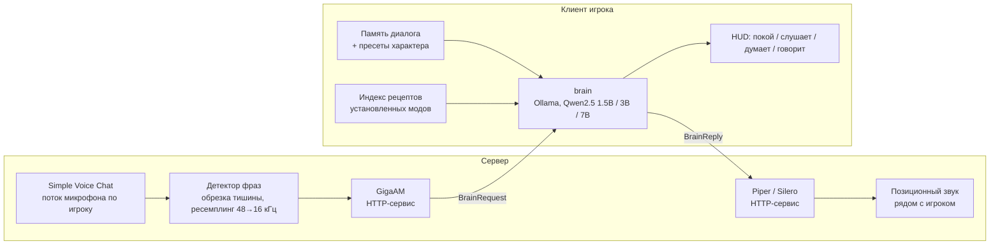

# NAGUMO AI — голосовой AI-компаньон для Minecraft

Мод для Minecraft (Fabric 26.2), который добавляет игроку компаньона с характером. С ним можно говорить голосом прямо в игре: компаньон слушает микрофон, понимает речь, отвечает с помощью локальной LLM и озвучивает ответ позиционным звуком рядом с игроком.

## Архитектура

## Ключевые решения

- **Инференс на железе игрока.** Аренда GPU под сервер стоила бы от ~$190 до ~$735 в месяц в зависимости от режима (расчёт в `costs.md`: Hetzner, RunPod, российские GPU-облака, цены API). Поэтому LLM работает локально у игрока, а сервер держит только голос.
- **Три уровня модели под видеопамять.** Мини (qwen2.5:1.5b) для слабых и встроенных GPU, лёгкая (3b) для 6–8 ГБ VRAM, средняя (7b) для 10–12 ГБ и выше. Переключение в настройках клиента; есть режим «без компаньона».
- **Голос на сервере.** Клиентский API Simple Voice Chat не даёт нужного доступа к потоку микрофона, поэтому захват, STT (GigaAM) и TTS (Piper, Silero) живут на сервере, а распознанный текст уходит клиенту по собственному сетевому протоколу.
- **Знания об игре без LLM.** Рецепты установленных модов индексируются и подставляются в контекст, чтобы модель не выдумывала крафты.
- **Личность.** Четыре переключаемых пресета характера и генератор уникальных позывных.

План этапов — `plan.md`, расчёт стоимости инфраструктуры — `costs.md`.

## Стек

Java · Fabric (Loom, Gradle, мультимодульный проект) · Simple Voice Chat API · Python · GigaAM (onnx-asr) · Piper · Silero · Flask · Ollama · Qwen2.5

## Модули

- `verity-common` — сетевые пакеты клиент ↔ сервер.
- `verity-client` — публикуемый мод: brain (LLM), память, HUD, настройки.
- `verity-server` — голосовой конвейер: приём микрофона, нарезка фраз, клиенты STT/TTS.
- `../gigaam-server`, `../silero-server` — HTTP-сервисы моделей распознавания и синтеза.

## Запуск

1. Поднять сервисы распознавания и синтеза речи: `start-all.bat` (GigaAM на порту 5002, Piper на 5001).
2. Установить Ollama и модель выбранного уровня, например `ollama pull qwen2.5:3b`.
3. Открыть `NAGUMO_AI` в IntelliJ IDEA как Gradle-проект и дождаться синхронизации.
4. Запустить сервер (`start-server.bat`) и клиент (`start-client.bat`); на сервере и клиенте должен стоять Simple Voice Chat.
